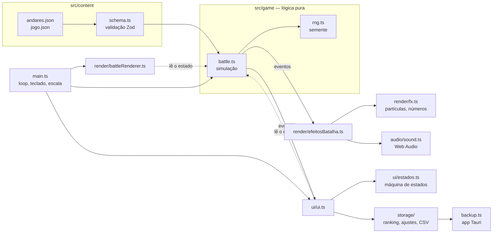

# Arquitetura do INVASÃO.EXE

Este documento explica como o código está organizado e por quê. Para rodar e testar, veja o
[README](../README.md).

## Visão geral



A regra principal: **a lógica do jogo não sabe que existe tela, som ou navegador.**

| Pasta | Responsabilidade | Pode usar DOM/canvas/som? |
|---|---|---|
| `src/content/` | Conteúdo (JSON) + schema que valida e gera os tipos | não |
| `src/game/` | Regras: inimigos, digitação, dano, combo, chefões, itens, conquistas | **não** (roda no Node) |
| `src/storage/` | Ranking, ajustes do painel, nick, CSV, backup em arquivo | só via interface `Armazenamento` |
| `src/render/` | Desenho no canvas e efeitos visuais | sim |
| `src/audio/` | Sons e música 8-bit sintetizados | sim |
| `src/ui/` | Telas, HUD, teclado dos menus, painel do organizador | sim |
| `src/paleta.ts` | As cores do jogo num lugar só (canvas e CSS usam as mesmas) | não |
| `src/main.ts` | Liga tudo: loop, escala da tela, captura de teclado, modos de teste | sim |

## Lógica pura + eventos

`Battle` ([src/game/battle.ts](../src/game/battle.ts)) guarda o estado da partida (`run`) e do andar
(`estado`) e avisa o que aconteceu por **eventos tipados** (`EventosBatalha`):

```ts
battle.on('inimigoAtingido', (inimigo, dano, critico) => { /* número flutuante, faíscas, som */ });
battle.on('andarConcluido', () => { /* tela de andar concluído */ });
```

A lógica diz *o que* aconteceu; [render/efeitosBatalha.ts](../src/render/efeitosBatalha.ts) e
[ui/ui.ts](../src/ui/ui.ts) decidem *como mostrar*. Por isso:

- os testes de unidade rodam a batalha inteira no Node, sem navegador, em milissegundos;
- trocar um som ou um efeito não arrisca quebrar uma regra do jogo (e vice-versa).

### Aleatoriedade com semente

Toda decisão aleatória da lógica (palavra sorteada, crítico, bloqueio, cartas) usa o gerador de
[rng.ts](../src/game/rng.ts), criado com uma **semente** por partida. Mesma semente = mesma partida,
o que permite reproduzir um bug (`?semente=123`) e escrever testes determinísticos. O visual (partículas,
chuva Matrix) tem um gerador separado ([render/aleatorio.ts](../src/render/aleatorio.ts)), para que um
efeito nunca mude o resultado da partida.

### Passo de tempo fixo

O loop ([main.ts](../src/main.ts)) avança a simulação em passos fixos de 1/60 s, independentemente do
fps da máquina. O jogo se comporta igual num notebook fraco e num PC rápido. Se a máquina travar, no
máximo 15 passos são recuperados (nada de "teletransporte" depois de um engasgo).

## Conteúdo validado

`andares.json` e `jogo.json` são validados por [schema.ts](../src/content/schema.ts) (Zod) ao abrir o
jogo, incluindo referências cruzadas (o sprite do chefão existe? a raridade da carta existe? a rota do
modo aponta para andares que existem?). Os tipos TypeScript saem do próprio schema (`z.infer`), então
conteúdo e código nunca divergem.

Os upgrades são **declarativos**: em vez de funções, cada carta lista efeitos
`{ atributo, op: 'add' | 'mul' | 'set', valor }`, aplicados por `aplicarEfeitos()`. Assim todo o
conteúdo é dado puro, editável sem programar.

## Interface: máquina de estados

Cada tela é um estado ([ui/estados.ts](../src/ui/estados.ts)) e a tabela `TRANSICOES` diz para onde cada
uma pode ir. Toda troca de tela passa por `irPara()`, que confere a tabela: em desenvolvimento, uma
transição inesperada lança erro; no evento, só registra no console (o quiosque nunca trava). Os testes
de unidade garantem que todas as telas são alcançáveis e que de qualquer tela dá para voltar ao título.

O que cada tecla faz em cada tela fica num único mapa (`TECLAS` em `ui.ts`).

### DOM seguro

As telas são montadas com `h()` ([ui/dom.ts](../src/ui/dom.ts)), que cria elementos e transforma todo
texto em **nó de texto**, nunca em HTML. Um nick como `` aparece na tela exatamente
assim, sem depender de lembrar de "escapar" cada valor (o antigo `innerHTML` + `esc()`).

## Mecânicas de jogo (versão 4)

Todas ficam na lógica pura (`battle.ts`) e todos os números ficam em `jogo.json` → `mecanicas`:

- **Inimigos:** cada tipo tem uma `mecanica` (`armadilha`, `replicar`, `embaralhar`, `atravessar`,
  `infectar`), tratada em `atualizarMecanica()` e, no caso do vírus, em `matar()`.
- **Chefões:** uma lista de `truques` por chefão, tratada em `atualizarChefe()`. Truques que escondem o
  texto (impressora, Wi-Fi, ransomware) usam `visivel`/`cifrado`. A interface não sabe deles: recebe a
  frase já mascarada em `prompt().mascara` (`Battle.mascarar`).
- **Contra-ataque, palavras especiais e overdrive:** dentro de `completar()`.
- **Dano no jogador:** tudo passa por `ferir()` (ataque, pacote que chegou, phishing, Modo Root), que
  cuida do combo, do backup e da morte num lugar só.
- **Rota, servidor e cartas:** `escolherRota()`, `apostarServidor()`, `rerrolar()`, e as sinergias em
  `aplicarUpgrade()`.
- **Fantasma:** a lógica anota a pontuação a cada 5 s de batalha (`run.trilha`);
  [storage/fantasma.ts](../src/storage/fantasma.ts) guarda a trilha do recordista de cada modo.
- **Ritmo** ([render/ritmo.ts](../src/render/ritmo.ts)): o hit-stop e a câmera lenta só mudam a
  velocidade do tempo no loop principal; as regras não sabem que existem.

**Balanceamento:** `npm run balanceamento` simula centenas de partidas
([tests/balanceamento](../tests/balanceamento/simular.test.ts)). Foi assim que os números da versão 4
foram ajustados para não deixar o jogo mais fácil que a versão 3.

## Design (versão 4)

- **Paleta:** [paleta.ts](../src/paleta.ts) tem todas as cores; as variáveis do CSS (`--verde`,
  `--vermelho`...) repetem os mesmos valores, e um teste de unidade confere que continuam iguais.
- **Cenários:** [render/cenarios.ts](../src/render/cenarios.ts) tem uma função por andar, que desenha
  com "pixels" de 4 px, translúcida, atrás da grade do chão. A chuva Matrix fica mais fraca na batalha.
- **Elevador:** [render/elevador.ts](../src/render/elevador.ts) é desenhado por cima da batalha enquanto
  o banner do andar está na tela; a UI informa há quanto tempo o banner abriu (`UI.elevador()`).
- **Animações:** [render/animacao.ts](../src/render/animacao.ts) guarda só estado visual (digitando,
  ferido), ligado pelos eventos da batalha em `efeitosBatalha.ts`. A lógica não sabe dele.
- **Ícones:** os símbolos são sprites 8×8 ([content/icones.ts](../src/content/icones.ts)). No HTML,
  [ui/icones.ts](../src/ui/icones.ts) troca o símbolo por um `` gerado do sprite; no canvas, o
  rótulo desenha o sprite direto.
- **Modo vitrine:** com o título parado, a UI começa uma partida marcada como `debug` (fora do ranking),
  com o som mudo, e `UI.passoVitrine()` digita como um jogador de ~90 ppm a cada quadro. Qualquer tecla
  ou clique chama `irTitulo()`.

## Render em duas camadas

O jogo é desenhado em 960×540 lógicos e ampliado para a tela:

- **camada base** (`#canvas`, sempre 960×540): fundo, sprites, partículas e barras. É ampliada por CSS
  com `image-rendering: pixelated`, então a pixel art mantém os pixels duros e o custo não aumenta com a
  resolução;
- **camada de texto** (`#canvas-texto`, na resolução real da tela): palavras sobre os inimigos, números de
  dano, falas e nome do chefão. Fica nítida em Full HD e 4K.

Desenhar o quadro **inteiro** na resolução real custava cerca de 3 vezes mais em PCs sem GPU (medido pelo
teste de desempenho), por isso só o texto paga esse preço. Em 960×540 as duas camadas viram uma só.

## Armazenamento

Ranking e ajustes recebem um `Armazenamento` (`ler`/`gravar`) em vez de acessar o `localStorage` direto:

- no navegador: `localStorage` protegido contra modo anônimo e disco cheio;
- nos testes: memória;
- no app Tauri: `localStorage` + **cópia em arquivo** a cada gravação, restaurada se o `localStorage`
  estiver vazio ([storage/backup.ts](../src/storage/backup.ts) e
  [src-tauri/src/main.rs](../src-tauri/src/main.rs)).

O ranking tem limite de 1000 registros **por modo**: um dia de muitas partidas rápidas não apaga o
ranking do modo normal.

## Build em arquivo único

O Vite com `vite-plugin-singlefile` gera **um único** `dist/index.html`, com JS, CSS e fontes embutidos.
Ele abre com dois cliques (via `file://`), sem servidor e sem internet. É o mesmo arquivo que o atalho
`INICIAR_EVENTO.bat` abre e que o Tauri empacota no executável.

## Testes

| Camada | Ferramenta | Onde | O que garante |
|---|---|---|---|
| Unidade | Vitest | `tests/unit/` | Regras da batalha, conteúdo, ranking, nick, CSV, estados, render com canvas falso, arquivos (ASCII/CRLF do `.bat`, caracteres invisíveis) |
| Ponta a ponta | Playwright | `tests/e2e/` | O **build real** via `file://`, com a rede bloqueada e falhando em qualquer erro de console. Relógio falso (`page.clock`): os 25 s de cada tela passam na hora |
| Visual | Playwright `toHaveScreenshot` | `tests/e2e/visual.spec.ts` | 18 telas comparadas com as referências em `tests/e2e/__screenshots__` |
| Robô | Playwright | `tests/e2e/robo.spec.ts` | Partidas completas em 4 velocidades + 20 min de uso contínuo |
| Mutação | Stryker | `stryker.config.json` | Os testes de unidade pegam bugs injetados na lógica |
